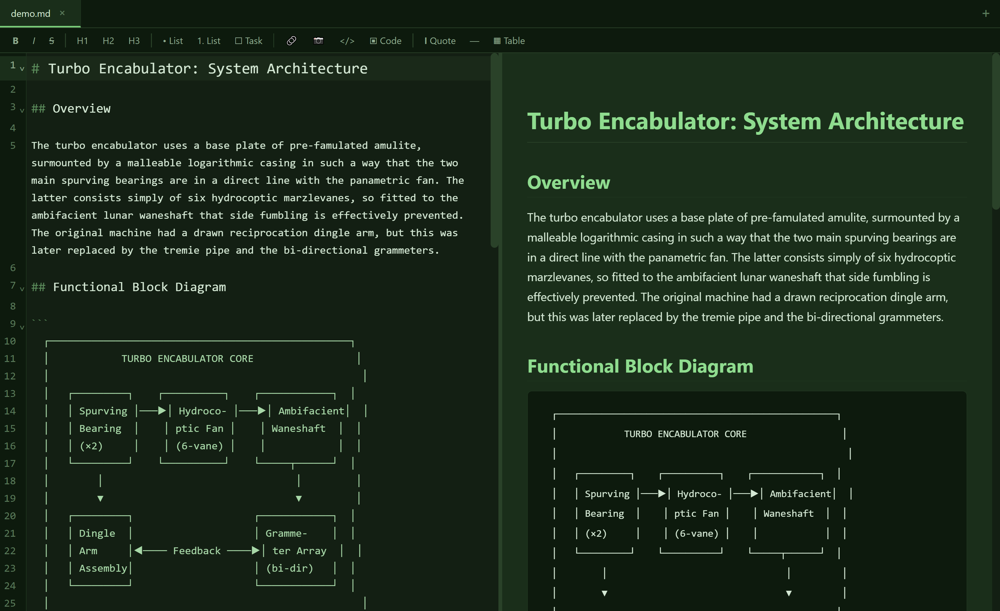

# Jade

A lightweight Markdown editor with live preview. No vaults. No bloat. Just Markdown.



## Features

- Split-pane editing: raw Markdown on the left, rendered preview on the right
- Near real-time preview with syntax-highlighted code blocks (15+ languages)
- Formatting toolbar (bold, italic, headings, lists, code, tables, links, images)
- Dark green theme
- Vim mode (toggle in status bar)
- Scroll sync with lock/unlock
- Tab management with modified indicators
- Export to PDF and LaTeX
- Drag images into the editor to insert Markdown image links
- View modes: split, editor-only, preview-only (Ctrl+1/2/3)
- Double-click any .md file to open it (after install)

## Install from release

Download the latest release for your platform from the [Releases](https://github.com/BradleyClymer/jade/releases) page.

| Platform | File | Notes |
|---|---|---|
| Windows (installer) | `Jade-Setup-x.x.x.exe` | Adds Start menu shortcut and .md file association |
| Windows (portable) | `Jade-x.x.x.exe` | No install needed, runs from anywhere |
| Linux | `Jade-x.x.x.AppImage` | `chmod +x` and run |
| Linux (Debian/Ubuntu) | `jade_x.x.x_amd64.deb` | `sudo dpkg -i jade_*.deb` |
| macOS | `Jade-x.x.x.dmg` | Requires code signing for Gatekeeper |

## Build from source

### Windows

Install [Node.js](https://nodejs.org/) 20+ (the installer adds it to PATH):

```powershell
git clone https://github.com/BradleyClymer/jade.git
cd jade
npm install
npm start
```

To build a Windows installer and portable exe:

```powershell
npm run dist:win
```

Output lands in `release/`. You get both `Jade-Setup-x.y.z.exe` (NSIS installer) and `Jade-x.y.z.exe` (portable), where the version comes from `package.json`.

### Ubuntu / Debian

Install Node.js 20+ and the build dependencies Electron needs:

```bash
# Node.js via NodeSource (if not already installed)
curl -fsSL https://deb.nodesource.com/setup_20.x | sudo -E bash -
sudo apt-get install -y nodejs

# Libraries Electron requires at runtime
sudo apt-get install -y libgtk-3-0 libnotify4 libnss3 libxss1 \
  libxtst6 xdg-utils libatspi2.0-0 libdrm2 libgbm1 libxcb-dri3-0

git clone https://github.com/BradleyClymer/jade.git
cd jade
npm install
npm start
```

To build an AppImage and .deb:

```bash
npm run dist:linux
```

Output lands in `release/`. Install the .deb with `sudo dpkg -i release/jade_*.deb`, or run the AppImage directly after `chmod +x`.

### macOS

```bash
brew install node    # or install from https://nodejs.org/
git clone https://github.com/BradleyClymer/jade.git
cd jade
npm install
npm start
```

To build a DMG (x64 + Apple Silicon):

```bash
npm run dist:mac
```

## Project structure

```
jade/
  main.js             Electron main process
  preload.js          contextBridge IPC layer
  build.js            esbuild bundler config
  renderer/
    index.html        App shell
    app.js            JadeApp class (CodeMirror, markdown-it, toolbar, exports)
    styles.css        Theme and layout
  assets/
    icon.svg          Source icon (editable)
    icon.png          512px PNG (used by electron-builder and the window)
  dist/
    bundle.js         Built renderer bundle (gitignored, generated by npm start)
```

### How the bundling works

The renderer uses ES module imports (CodeMirror 6, markdown-it, highlight.js). `build.js` runs esbuild to bundle these into a single `dist/bundle.js` IIFE that the HTML loads as a regular script. The main process and preload are plain CommonJS and don't need bundling. `npm start` runs the bundler automatically before launching.

## Keyboard shortcuts

| Action | Shortcut |
|---|---|
| New file | Ctrl+N |
| Open file | Ctrl+O |
| Save | Ctrl+S |
| Save as | Ctrl+Shift+S |
| Close tab | Ctrl+W |
| Find | Ctrl+F |
| Replace | Ctrl+H |
| Editor only | Ctrl+1 |
| Split view | Ctrl+2 |
| Preview only | Ctrl+3 |
| Cycle views | Ctrl+P |
| Zoom in/out/reset | Ctrl+= / Ctrl+- / Ctrl+0 |

## License

MIT
