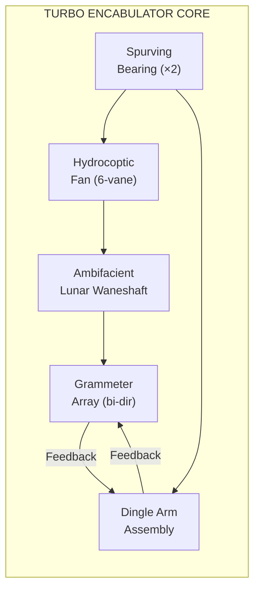

# Turbo Encabulator: System Architecture

## Overview

The turbo encabulator uses a base plate of pre-famulated amulite, surmounted by a malleable logarithmic casing in such a way that the two main spurving bearings are in a direct line with the panametric fan. The latter consists simply of six hydrocoptic marzlevanes, so fitted to the ambifacient lunar waneshaft that side fumbling is effectively prevented. The original machine had a drawn reciprocation dingle arm, but this was later replaced by the tremie pipe and the bi-directional grammeters.

## Functional Block Diagram



## Key Parameters

| Subsystem | Rating | Tolerance | Notes |
|---|---|---|---|
| Spurving bearings | 12.4 kRf | ±0.003 Rf | Pre-famulated |
| Marzlevanes | 6 per fan | N/A | Hydrocoptic only |
| Lunar waneshaft | 220 V reluctance | ±2.1% | Ambifacient |
| Dingle arm | 7.3 tremie-units | ±0.8 tu | Drawn reciprocation |
| Differential girdlespring | 14 µPz | ±0.01 µPz | Cardinal type |

## Nofer Trunnion Coupling

The main winding was of the normal lotus-o-delta type placed in panendermic semi-boloid slots of the stator, every seventh conductor being connected by a non-reversible tremie pipe to the differential girdlespring on the up end of the grammeters.

```python
class NoferTrunnion:
    """Manages sinusoidal deplanaration across the spur axis."""

    def __init__(self, deplanaration_coeff=0.0042):
        self.coeff = deplanaration_coeff
        self.girdlespring = DifferentialGirdlespring(cardinal=True)
        self.marzlevanes = [Marzlevane(i) for i in range(6)]

    def compute_reluctance(self, waneshaft_rpm):
        base = sum(m.hydrocoptic_index for m in self.marzlevanes)
        return base * self.coeff / (waneshaft_rpm + 1e-9)

    def prevent_side_fumbling(self):
        for vane in self.marzlevanes:
            vane.align_to_panametric_axis()
        self.girdlespring.engage(mode="cardinal")
```

## Performance Envelope

The original turbo encabulator achieved a sinusoidal deplanaration index of **0.0042** across all six hydrocoptic marzlevanes. With the addition of the drawn reciprocation dingle arm, this was improved to **0.0019**, well within the Penrose limit for non-reversible tremie configurations.

> **Warning:** Do not exceed 14 µPz on the differential girdlespring without first disengaging the ambifacient lunar waneshaft. Failure to observe this precaution may result in uncontrolled side fumbling.

### Operational Modes

1. **Panametric** — standard six-vane configuration, logarithmic casing closed
2. **Semi-boloid** — every seventh conductor bypassed, reduced deplanaration
3. **Cardinal** — differential girdlespring at full engagement, maximum reluctance damping

## References

- Bud Haggart, *Turbo Encabulator Theory and Practice*, Rockwell Automation, 1977
- J. H. Quick, "On the Sinusoidal Deplanaration of Hydrocoptic Marzlevanes," *Journal of Prefamulated Systems*, vol. 12, pp. 44–51, 1988
